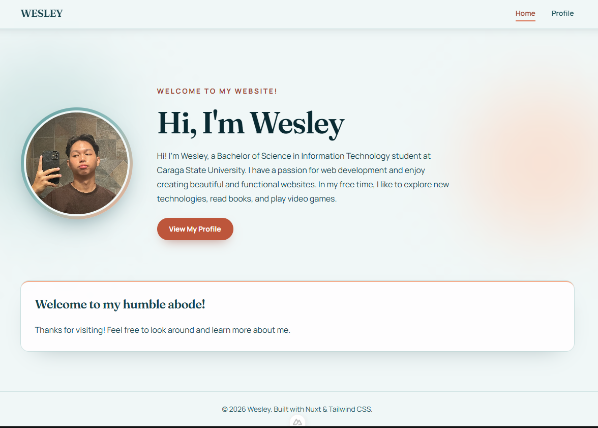
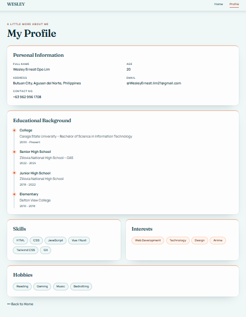
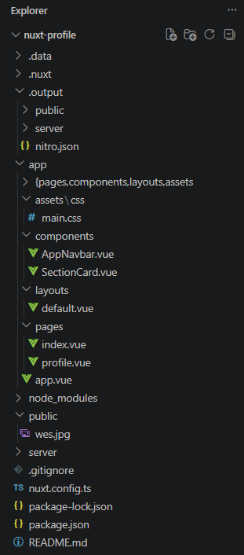

# Personal Profile Website

A two-page personal profile website built with **Nuxt 4** and **Tailwind CSS**. It has a homepage that introduces me and a profile page with my personal information, education, skills, interests, and hobbies.


## Screenshots

| Homepage | Profile Page |
| :------: | :----------: |
|  |  |

Project folder structure:



## Features

- **Homepage:** name, short introduction, profile picture, navigation menu, and welcome message
- **Profile page:** personal information, educational background, skills and interests, and hobbies
- **Navigation:** links between both pages with an active-link highlight
- **Reusable components:** shared navbar and section card
- **Shared layout:** navbar and footer defined once and used on every page
- **Responsive design:** works on mobile and desktop

## Tech Stack

| Tool | Purpose |
| ---- | ------- |
| [Nuxt 4](https://nuxt.com) | Vue framework with file-based routing |
| [Vue 3](https://vuejs.org) | UI components |
| [Tailwind CSS v4](https://tailwindcss.com) | Utility-first styling |
| Node.js 20+ | Runtime |

## Project Structure

```
nuxt-profile/
├── app/
│   ├── app.vue                  # Root: <NuxtLayout> + <NuxtPage>
│   ├── assets/css/main.css      # Loads Tailwind CSS
│   ├── components/
│   │   ├── AppNavbar.vue        # Navigation menu
│   │   └── SectionCard.vue      # Reusable card for profile sections
│   ├── layouts/
│   │   └── default.vue          # Navbar + page content + footer
│   └── pages/
│       ├── index.vue            # Homepage  (route: /)
│       └── profile.vue          # Profile   (route: /profile)
├── public/
│   └── wes.jpg               # Profile picture (static file)
├── screenshots
├── server
├── nuxt.config.ts               # Nuxt config (Tailwind via Vite plugin)
├── package.json
└── README.md
```

| Folder | What it does |
| ------ | ------------ |
| `app/pages` | Each `.vue` file becomes a route automatically |
| `app/components` | Reusable pieces of UI, auto-imported |
| `app/layouts` | Wrapper shared by pages (navbar and footer) |
| `public` | Static files served as-is, like `/avatar.svg` |

## Getting Started

### Prerequisites

- [Node.js](https://nodejs.org) version 20 or newer (check with `node -v`)
- npm (comes with Node.js)

### Installation

```bash
# 1. Clone the repository
git clone https://github.com/your-username/nuxt-profile.git

# 2. Go into the project folder (the one that contains package.json)
cd nuxt-profile

# 3. Install dependencies
npm install

# 4. Start the development server
npm run dev
```

Open <http://localhost:3000> for the homepage and <http://localhost:3000/profile> for the profile page.

### Other Commands

| Command | Description |
| ------- | ----------- |
| `npm run dev` | Start the development server |
| `npm run build` | Build for production |
| `npm run preview` | Preview the production build |
| `npm run generate` | Generate a static site |


## Troubleshooting

- **`npm install` says it can't find `package.json`:** you're in the wrong folder. Run `dir` (Windows) or `ls` (Mac/Linux) and `cd` into the folder that contains `package.json`.
- **Changes don't show up:** save the file, then hard refresh the browser (Ctrl+Shift+R). If you edited `nuxt.config.ts` or `main.css`, restart the dev server.
- **Errors on Windows:** keep the project in a simple path such as `C:\projects\`, not inside OneDrive or a folder with non-English characters.

## Author

**Wesley Ernest O. Lim**
ITE18-BJEM1 , Caraga State University
Email: wlim660@gmail.com
GitHub: [@your-username](https://github.com/Lim)

## Acknowledgments

Built as a school activity on creating a two-page website with Nuxt.js and Tailwind CSS.